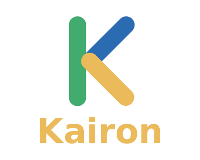

# Kairon - Sitio Web Corporativo



## Descripción del Proyecto

Este es el repositorio oficial del sitio web corporativo de **Kairon SpA**, una empresa dedicada a la gestión integral del factor humano en organizaciones públicas y privadas de Chile. El sitio web está diseñado para comunicar la propuesta de valor de la marca: "Cuidamos Personas, Fortalecemos Empresas", enfocándose en la prevención del riesgo psicosocial, la salud mental y la seguridad laboral.

El diseño web destaca por ser moderno, limpio, corporativo y 100% responsivo, garantizando una excelente experiencia de usuario tanto en dispositivos móviles como en pantallas de escritorio.

## Características Principales

*   **Arquitectura Modular:** Utilización de PHP para modularizar componentes clave (como la navegación y el pie de página), facilitando la escalabilidad y el mantenimiento del código.
*   **Diseño Responsivo (Mobile-First):** Interfaz adaptable a múltiples resoluciones gracias al uso avanzado de CSS Grid y Flexbox.
*   **Formulario de Contacto Funcional:** Integración de un script en PHP (`enviar.php`) para el procesamiento seguro y envío de cotizaciones o consultas de clientes.
*   **Identidad Visual Coherente:** Uso sistemático de variables CSS para mantener la paleta de colores de la marca (Verde, Azul, Crema y Dark) en todas las secciones.

## Tecnologías Utilizadas

Este proyecto fue construido utilizando un stack clásico y sólido de desarrollo web:

*   **HTML5:** Estructura semántica de las páginas (`index.php`, `pilares.php`, `identidad.php`).
*   **CSS3:** Estilos en cascada (alojados en `assets/css/styles.css`), uso de variables (`:root`), Grid, Flexbox y media queries para la adaptabilidad.
*   **JavaScript (Vanilla):** Interactividad del sitio, manejo del menú hamburguesa en móviles y estados activos de navegación (`assets/js/script.js`).
*   **PHP:** Lógica del lado del servidor para componentes reutilizables (`nav.php`, `footer.php`) y envío de correos electrónicos.
*   **FontAwesome (v6.4):** Implementación de iconografía vectorial para ilustrar servicios y valores.
*   **Google Fonts:** Uso de la familia tipográfica *Inter* para una lectura digital óptima.

## Estructura del Proyecto

```text
kairon/
├── assets/
│   ├── css/
│   │   └── styles.css       # Estilos globales y específicos
│   ├── img/                 # Imágenes, fotografías y logos de la marca
│   └── js/
│       └── script.js        # Interactividad y lógica frontend
├── index.php                # Página de inicio (Landing)
├── pilares.php              # Página de servicios y metodología
├── identidad.php            # Página de propósito, misión, visión y valores
├── nav.php                  # Componente modular del menú de navegación
├── footer.php               # Componente modular del pie de página
├── enviar.php               # Script de procesamiento del formulario
└── README.md                # Documentación del proyecto
```

## 📄 Licencia

© 2026 KAIRON SpA. Todos los derechos reservados.